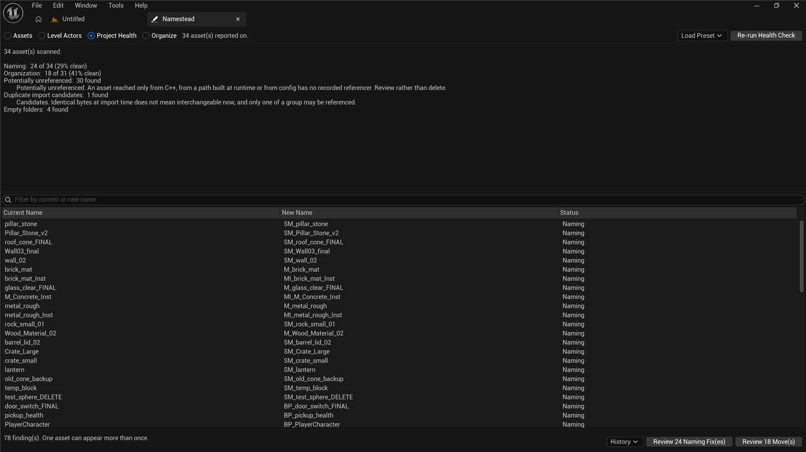
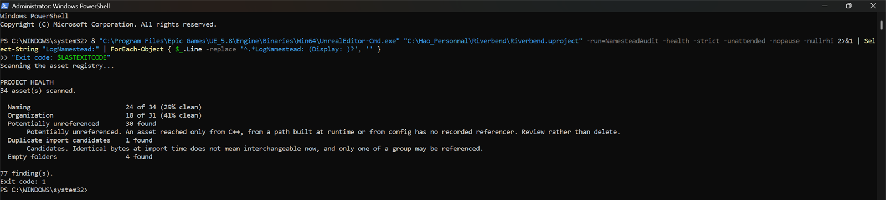
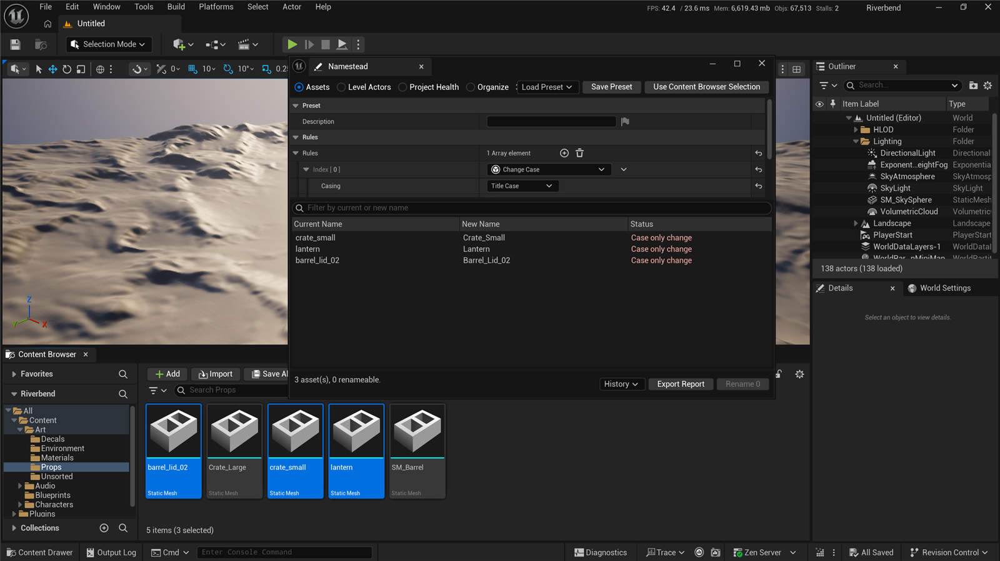

## Overview

Large Unreal projects drift. Names stop matching whatever convention they started with, assets
end up in the wrong folders, and nothing notices until someone goes looking. Unreal already
ships a batch renamer, which does the mechanical part and knows nothing about what *correct*
means for your project.

Namestead starts from one idea: **define what a correct name and location look like once, as
a chain of rules**, That one definition then does three jobs: bulk rename with a live
preview, project-wide enforcement through the engine's own Data Validation, and
whole-project reporting. Nothing is renamed until it has been previewed.

It is released on Fab for Unreal Engine 5.6, 5.7 and 5.8. This page describes the software and
how it is built; it makes no claims about sales, users or commercial outcomes, because I have
none to make.

## Problem and goals

A bulk rename tool is deceptively easy to write badly. The naive version is a string
transformation plus a loop calling rename, and it has three serious problems:

1. **It cannot tell you what is about to happen.** Renaming a referenced asset repoints
   everything that points at it — assets that were never part of your selection.
2. **Some renames destroy data.** In Unreal, a rename that changes only letter case is one of
   them (see below).
3. **The definition of "correct" lives only in the tool.** Rename today, drift again next
   month, with nothing enforcing the convention in between.

The goals that followed:

- Name generation must be **incapable** of modifying an asset.
- Every refusal must be visible with its reason, not quietly dropped.
- The same rules must work as a project-wide convention and from a build machine.
- The whole rule layer must be testable without creating assets.

## My role

Sole author. Product design, all of the C++, the Slate panel, the validation and safety
behaviour, the test suite, the two multi-engine verification scripts, the documentation site,
and the Fab submission.

The source is not public: it is a commercial product. This case study is written to stand on
its own, from the published documentation and behaviour rather than implementation detail
you cannot check.

## Technical implementation

The pipeline is deliberately split so that the dangerous half is small and late:

```
Selection → Rule chain → Proposed names → Validation → Preview → Execution
            (pure)                        (registry)             (IAssetTools)
```

Name generation is separate from execution, which means **building a preview cannot modify an
asset** — not as a matter of care, but as a matter of structure. Execution then goes through
`IAssetTools::RenameAssets` rather than touching `.uasset` files, which leaves redirectors,
reference fix-up and asset-registry state to the engine where they belong.

### The rule layer is pure, and that is what makes it testable

Every rule implements one method:

```cpp
virtual FString Apply(const FNamesteadRuleContext& Context) const;
```

The context carries the original name, the name so far, the asset's class, its folder and its
index in the batch. A rule has **no access** to the asset registry, the filesystem, or a
`UObject`. That is why the entire rule layer — the largest part of the plugin — can be
exercised without creating a single asset, and why the test suite runs anywhere, headless
included.

Twelve rule types ship with it — prefix, suffix, find and replace, regex replace, change case,
asset type prefix, remove prefix, remove suffix, remove numbering, sequential numbering,
separator cleanup, and a name pattern such as `{TYPE}_{NAME}_{INDEX}` that can be scoped to a
single asset class. They are composable and order dependent, each receiving what the previous
one produced:

```
Door                    original
SM_Door                 asset type prefix
ENV_SM_Door             prefix "ENV_"
ENV_SM_Door_001         sequential numbering
```

Rules derive from an exported base in `Public/` and are marked `EditInlineNew`, so their
parameters are editable through an ordinary details view — adding a rule type means
subclassing the base and overriding `Apply`, and **nothing in the UI changes**. A studio can
keep its own rules in its own editor module without forking the plugin.

### One definition, used three ways

The rule chain saves as a preset asset in the project, so a team versions its naming
alongside the assets it describes. Setting it as the convention points the project at it,
and those rules then run wherever the engine validates — the Validate Assets action, and the
Data Validation commandlet in CI. A name that does not match is a warning by default. Turn
on *Treat Violations As Errors* and it fails the run, so a team can adopt the convention
before it starts breaking builds.

Any rule that depends on an asset's position in a batch is left out of that path: it cannot
judge one asset alone. The row says so rather than passing quietly. A convention is just a
rule set: an asset complies when running the rules over its name changes nothing, and the
violation message *is* the name the rules would have produced.



*Five categories in one pass. The buttons turn what it found back into an ordinary preview.*

### Honest reporting was a design problem, not a formatting one

The health report makes three decisions I would defend in an interview:

- **A percentage appears only where there is something honest to divide by.** The
  organization check divides by the assets the folder plan has an opinion about, not the
  whole project — otherwise a plan covering one class scores a project 99% organised on the
  strength of saying almost nothing. Unreferenced assets and duplicate candidates get a count
  and no percentage: neither is necessarily a defect, and a score would read as a defect rate
  it is not.
- **Not configured is never reported as clean.** A project with no convention set has not
  passed the naming check, it has declined to take it. With neither a convention nor a folder
  plan configured, the report says so and exits non-zero.
- **A partial check says so.** Rows that could not be fully checked are marked rather than
  reported as passing.

Two report categories are named for what they can actually prove. "Potentially unreferenced"
is not *unused* — an asset reached only from C++, from a runtime-built path or from config has
no recorded referencer, so the list is for review, not deletion. "Duplicate import candidates"
groups by the hash the engine recorded at import, which proves two assets came from identical
bytes at that time and nothing about whether they are interchangeable now. Nothing in the
plugin offers to delete anything, which is deliberate.

### Headless, with exit codes

All of it runs without the editor UI, which is what makes it usable as a build step:



*The audit commandlet. `-strict` exits non-zero when anything is found.*

Moves are the same machinery: a move in Unreal is a rename with a different package path, so
the organize path produces ordinary rename plans and shares the same validation, collision
checking, referencing count and reporting.

### Undo, and why there is not one

A batch asset rename cannot be undone with Ctrl+Z, and the reason is structural rather than an
omission. Undo replays serialized property data — and an object's **name and outer are not
property data**. So even where the engine does record the object, there is nothing in that
record that puts the name back. Wrapping `IAssetTools::RenameAssets` in an `FScopedTransaction`
does not help; Epic's own renamer wraps its rename in one anyway, which is worse than offering
nothing, because it looks like an undo and is not.

What Namestead does instead is the thing that actually works. Every run is recorded to the
project's `Saved` folder as a CSV, automatically, whether it came from the panel or the
commandlet. That record is an audit trail and also the way back: **History → pick a run → Load
This Run in Reverse**. Every rename it made is pointed the other way and arrives as an ordinary
preview — same validation, same collision check, same referencing count, same button, nothing
moved until you press it.

It is still not an undo, and the difference is worth stating rather than glossing. It
resolves every asset against the project *as it stands now*, not as the report remembers it.
Anything renamed, moved or deleted since is left out, with the count shown on screen. A name
something else has taken is refused in its own row, like any other collision. What comes
back is what can come back, and you see exactly that first. In exchange it works after the
editor has been closed and reopened, which is the part Ctrl+Z cannot do.

One detail I would want to be asked about: **reversals are walked back to front.** Within a
batch, a later rename may have freed the name an earlier one wanted. Undoing in the order
things happened walks *into* that collision instead of out of it.

Renaming level actors is the exception and genuinely does undo, with one Ctrl+Z for the
whole batch, because a label change goes through `Modify` and the batch runs in one
transaction. That asymmetry is why actors are a separate mode, not a checkbox. One needs a
recorded history, the other does not, and a single mode would have to lie about one of them.

## Key engineering challenges

**The rename that destroys the asset.** A rename changing only letter case does not fail
loudly. The engine renames the package in memory, reports success, then cannot write the new
file beside the old one on a case-insensitive filesystem — and nothing survives under either
name. I found this against a real asset, which did not come back.

Namestead refuses those. The refusal is part of the interface, not a silent skip: the rows
stay visible with their reason, and the action button's count drops to match. The message
also says what to do instead — rename through a different name, which works.



*The rows stay visible with their reason, and the button drops to zero.*

The same treatment covers the other cases where a rename is not safe to attempt. A World
Partition or One File Per Actor map keeps its actors in generated packages under a folder
named after the map. Nothing in the engine moves that folder when the map is renamed. The
map opens with none of its actors in it, and the engine reports success. Refused, with a
pointer to the engine's own tool for the job. Also refused: two assets in one batch heading
for the same name, a name another asset in the batch is still moving out of, and engine or
script content.

**A count that tells the truth.** The button says how many assets will actually change,
which is not how many are selected — assets that already comply say so and are excluded, as
is anything validation refused. Separately, a line under the table reports how many assets a
rename would *also rewrite*. Repointing referencing assets is the part a user never selected
and would not otherwise see coming.

**Two verification passes that each catch what the other cannot.** Compatibility is rebuilt
by two scripts that check deliberately opposite things. One packages against every installed
engine with the same `RunUAT BuildPlugin` a marketplace submission uses, plus
`-StrictIncludes`. That disables the precompiled header and the unity build, so every header
has to compile on its own. The other builds a throwaway host project per engine and runs the
whole suite in each with `-DisableAdaptiveUnity`, which forces translation units *together*.

Neither finds what the other does. Unity concatenation catches two file-local helpers
colliding under one name, and hides a header leaning on its neighbour. Strict includes takes
them apart: it catches the second and cannot see the first. Both have caught a real defect
that got past every other check.

**Compiling is the weaker claim.** The test pass exists because building successfully does not
mean working. It found a defect the build pass could not: three rule sets shipped as assets
loaded on 5.8 and on nothing older, because a package carries the version of the engine that
saved it. They are built in code now, which is also why the built-in presets are never empty
on a first run regardless of engine version.

## Testing and verification

- **56 test groups** cover the rules, discovery, validation, the preview the panel shows,
  execution reporting, presets, conventions, auditing, organizing and actor renaming.
- They **create no assets**, a direct consequence of the pure rule layer, so they run headless
  with a null RHI and are usable in CI.
- The suite runs on **five engine versions** — 5.4 through 5.8 — and passes on all of them.
  Fab offers 5.6 and up because Epic builds a submitted plugin against the three latest
  versions by default; 5.4 and 5.5 are tested every pass and build from source.
- **No engine version guards in the source.** Compatibility is verified rather than branched
  around.

| Engine | On Fab | Tests |
| --- | --- | --- |
| 5.8 | Yes — developed against | 56 of 56 pass |
| 5.7 | Yes | 56 of 56 pass |
| 5.6 | Yes | 56 of 56 pass |
| 5.5 | No | 56 of 56 pass |
| 5.4 | No | 56 of 56 pass |

## Current status and limitations

Released and feature-complete for what v1.0 set out to do. The limits worth stating:

- **Win64 only.** The module declares a Win64 platform allow list. There is no
  platform-specific code in it — everything goes through `FPaths` and `IFileManager` — so it
  would very likely build and run on a macOS or Linux editor. It is restricted because it has
  never been run on one.
- **There is no Ctrl+Z for an asset rename**, for the structural reason above. The recorded
  history and its reverse-run are the mitigation, and they are deliberately presented as a
  preview rather than as an undo, because that is what they are.
- **Renaming an asset placed in a level leaves a redirector**, unconditionally. The engine
  refuses to load map packages for reference fix-up, so this is not something the plugin can
  avoid — it is reported rather than hidden.
- **Two reports are advisory by design**, as described above, and neither offers to delete
  anything.
- **The source is not public.** This case study is deliberately written to be checkable
  without it: the documentation describes every behaviour claimed here, and the plugin itself
  is the artefact.

## Next steps

- macOS and Linux editor support, which is a testing exercise rather than a porting one.
- Older engine versions on the listing, which Epic allows by request.
- Making the folder plan and the convention easier to adopt mid-project, where the first run
  produces the largest and least reviewable batch.
